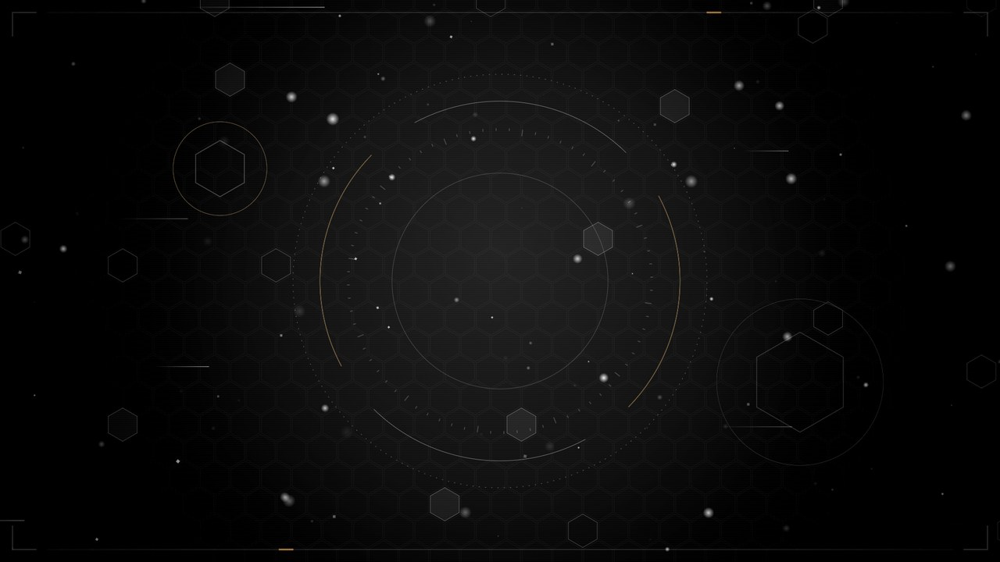

# SAO Desktop Menu

**A Sword Art Online–style app launcher for your Windows desktop.**
Hold the middle mouse button on the desktop, drag down, and a column of glowing round
buttons slides down, with every app on your PC sorted into categories.

*by **Arthur_Zid*** · MIT License

▶️ **[Watch the full demo video](docs/demo.mp4)** (30 s, with the LINK START intro)

---

## Features

- **Swipe to open:** on an empty spot of the desktop, hold the middle button (scroll wheel) and drag down a little. The menu appears right where you started.
- **Every app, sorted automatically:** reads your Start menu and files each app into categories like Games, Web & Chat, Work, Creative, Media and Utilities.
- **Subcategories:** Games → *Games / Launchers*, Web & Chat → *Web / Chat*, Work → *Office / Dev Tools / Engineering*, Other → *System*. They open as a second sliding panel.
- **Real app icons:** uses the same icons as the Windows Start menu.
- **Type to search:** start typing while the menu is open, then press Enter to launch.
- **Edit it from the menu:** *Other › Edit menu* lets you add apps (with a Browse button), remove them and restore them. You can also right-click any app to remove it.
- **SAO-style wallpapers:** black, night, sky and sunset, in 1080p and 1440p.
- **Optional LINK START intro:** when the PC starts, the screen goes black, "LINK START" lights up, and you rush through a tunnel of light into your desktop. Skip it with any click or key; turn it on or off in the installer or with `"intro"`.
- **Sound effects:** small chimes made on the fly, with no audio files.
- **Light:** about 1% CPU and ~300 MB RAM while closed. Works fully offline.

| Black | Night |
|---|---|
|  |  |

## Install

Pick **one** of the two ways:

### Option A: Easy installer (recommended)
1. Go to **Releases** and download **`SAO-Desktop-Menu-Setup.exe`**.
2. Run it and click **Next → I accept → choose your options → Install → Finish**.
   - Options: start at login · LINK START intro · SAO wallpaper · desktop shortcut
3. Done. Hold the middle mouse button on the desktop and drag down.

No Python needed. It installs just for you (no admin password) and shows up in
**Settings → Apps**, where you can uninstall it like any other app (your old wallpaper comes back).

### Option B: Manual (ZIP + Python)
**Needs:** [Python 3](https://www.python.org/downloads/). When installing Python, tick **"Add python.exe to PATH"**.

1. Download **`SAO-Desktop-Menu.zip`** from **Releases** (or **Code → Download ZIP**).
2. Unzip it somewhere you'll keep it, e.g. `Documents\SAO-Desktop-Menu`.
3. Double-click **`install.bat`**. It installs the one extra package it needs (Pillow), asks if it should start automatically at login and whether to play the LINK START intro, and turns the menu on.

Both ways need Windows 10/11 and Microsoft Edge (built in).

> Windows may show *"Windows protected your PC"* because the app isn't digitally signed.
> Click **More info → Run anyway**.

## Use

| Action | What it does |
|---|---|
| Hold middle button + drag down on the desktop | Open the menu |
| Click a round button | Show that category |
| Click an app | Open it |
| Type | Search all apps (Enter opens the top result) |
| Arrow keys + Enter | Move around with the keyboard |
| Right-click an app | Remove it from the menu |
| Esc, or click empty space | Close the menu |

| File | Purpose |
|---|---|
| `start.bat` | Turn it on (your current wallpaper is backed up first) |
| `stop.bat` | Turn it off and restore your previous wallpaper |
| `uninstall.bat` | Turn it off and remove it from startup, then delete the folder |
| `setup-startup.ps1` | Add (or with `-Remove`, remove) start-at-login |

*(Option B files. With the installer, use the Start menu: "SAO Desktop Menu" and "Stop SAO Desktop Menu".)*

## Customize

The easiest way is **Other › Edit menu** inside the menu itself.
Everything is also in `apps.json` (created on first run):

| Setting | Example | What it does |
|---|---|---|
| `wallpaper` | `"wallpapers\\sao-wallpaper-black-1920x1080.png"` | Choose the wallpaper |
| `sound` | `true` / `false` | Menu sound effects on/off |
| `intro` | `true` / `false` | LINK START animation at login (preview: `python launcher.py --intro`) |
| `hide` | `["ODBC*", "Calculator"]` | Leave apps out (`*` wildcards work) |
| `hide_categories` | `["Trading"]` | Leave whole categories out |
| `keep_only` | `{"Work/Engineering": ["SOLIDWORKS 2025", "QGIS*"]}` | Show only these apps in a (sub)category |
| `move` | `{"Wallpaper Engine": "Creative"}` | Put an app in another (sub)category, e.g. `"Work/Office"` |
| `extra` | `[{"category": "Games", "name": "Minecraft", "target": "C:\\...\\Minecraft.exe"}]` | Add your own apps, folders or websites |

## LINK START voice

When the optional intro plays, it uses the first voice it finds:

1. **Your own clip**: put any audio file on your PC and add `"intro_voice": "C:\path\to\clip.mp3"` to `apps.json`
   (or `"intro_voice": false` to always use Windows' built-in voice).
2. **The voice that ships with the app**: `sounds/link-start.mp3` (or `.m4a` / `.wav` / `.ogg`).
3. **Windows' built-in voice** saying "Link start", if neither of the above exists.

## How it works

- `launcher.py` is a small local helper. It scans your Start menu, finds the icons (`icons.ps1`), sets the wallpaper, and watches for the middle-button swipe on the desktop.
- The menu (`sao-desktop.html`) runs in a hidden Microsoft Edge window that pops up when you swipe. To look see-through, it takes a quick snapshot of the screen as its background. The snapshot stays in memory only and is never saved.
- Everything stays on your computer. The helper only listens on `127.0.0.1` and only opens apps from your Start menu or your own list.

## Building the installer

You don't need to build anything yourself: when a **Release** is published, GitHub builds
`SAO-Desktop-Menu-Setup.exe` automatically (see `.github/workflows/build.yml`) using
[PyInstaller](https://pyinstaller.org) and [Inno Setup](https://jrsoftware.org/isinfo.php) (`installer.iss`),
and attaches it to the Release. You can also run it by hand: **Actions → Build installer → Run workflow**.

## License

[MIT](LICENSE.txt) © 2026 **Arthur_Zid**. Free to use, change and share; keep the copyright notice.

Made by **Arthur_Zid** · built with the help of [Claude](https://claude.ai) (Anthropic)

*Fan-made project inspired by the menu style of the Sword Art Online anime. Not affiliated
with or endorsed by the creators or rights holders of Sword Art Online. It contains no
artwork, characters or logos from the series.*
